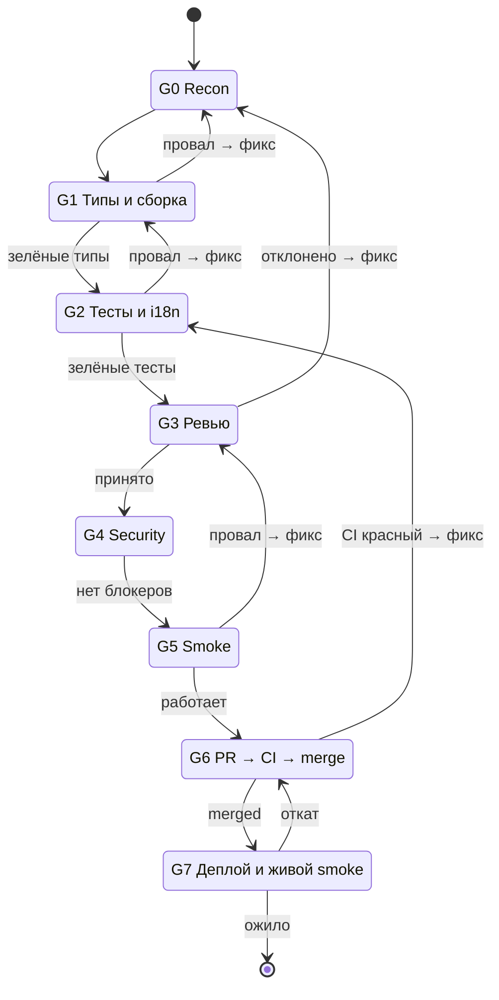

# 03 — Definition of Done и рубрика гейтов G0–G7

Этот файл определяет, что значит «готово» и как это доказывается.
Главное правило: **гейт зелёный только с evidence**. Evidence = команда + ключевой вывод + SHA ревизии; артефакты (лог, скриншот, JSON) прикладываются к PR.

«Планы написаны», «тесты зелёные», «PR открыт» — **не** готовность.

## 1. Универсальный Definition of Done

Готово, когда **все** пункты истинны:

- [ ] Код в `main` через PR (merge-коммит); ветка-слайс — самодостаточный кандидат на откат.
- [ ] Типы и сборка затронутых поверхностей зелёные (**G1**).
- [ ] Тесты: затронутые наборы + новые зелёные; для багфиксов/фич есть RED-first evidence (**G2**).
- [ ] `knownRed` не вырос; новых флаки не появилось (**G2**).
- [ ] i18n: 12 локалей в паритете, ключи ASCII-сортированы — для UI-строк (**G2**).
- [ ] Независимый reviewer принял (артефакты сверены); adversary прошёл на рискованных путях (**G3**).
- [ ] Security-ревью для чувствительных путей (**G4**).
- [ ] Runtime smoke изменённой поверхности; для UI — скриншот с SHA (**G5**).
- [ ] Документация/решения обновлены (decision records — в `plans/*/decisions/`).
- [ ] PR merged; CI зелёный; обязательный `freshness` пройден (**G6**).
- [ ] Деплой выполнен существующим пайплайном + живой smoke, **или** `BLOCKED` (нет канала/креды — точный OPS-чеклист) (**G7**).
- [ ] Отчёт по формату `00-orchestrator.md` §11.

Дельты по типам задач (фича/багфикс/prefactor/миграция/ADR/релиз) — в `05-archetypes.md`.

## 2. Таблица гейтов

| Гейт | Суть | Средство | Pass-условие | Evidence |
|---|---|---|---|---|
| **G0 Recon** | База, область, владение | `git fetch origin main` + worktree; чтение доков | Карта области + база SHA + ownership map + точка отката | SHA, карта |
| **G1 Типы/сборка** | Типы и сборка затронутого | `bun run typecheck:all` (+ per-package `tsc --noEmit`, точечные build-скрипты) | 0 ошибок | Вывод команды |
| **G2 Тесты** | Затронутые + новые тесты; i18n; ratchet | `bun test <пути>`, `bun run lint:i18n:*`, `bun run test` | Зелёные; `knownRed` не выше базлайна; RED-first | Выводы, счётчики |
| **G3 Ревью** | Независимый reviewer + adversary | OMP-субагент `reviewer` (fresh context) | Принято; артефакты сверены с источником | Verdict |
| **G4 Security** | Чувствительные пути | Субагент `security-reviewer` | Нет блокеров | Отчёт |
| **G5 Smoke** | Изменённая поверхность | `electron:dev` / `webui:dev` / `server:dev` / `viewer:dev` / CLI | Работает; UI — визуально | Скриншот/лог с SHA |
| **G6 Ship** | PR → CI → merge | `gh pr create`, `gh pr checks --watch`, `gh pr merge <N> --merge` | Merged; `freshness` пройден | PR#, merge SHA |
| **G7 Deploy+Live** | Деплой + живой smoke | Канал по поверхности (`06-runbook.md` §6): desktop — release-flow; cloud-gateway — CircleCI; server/webui/viewer — канала в репо нет → OPS-чеклист | Канал есть: ожило и проверено; канала нет: `BLOCKED` + OPS-чеклист (локальный build/run = G5, не G7) | URL/лог/скриншот |

## 3. Детали гейтов

### G0 — Recon
- База — свежий `origin/main` (SHA фиксируется до первой правки). Работа от устаревшей базы запрещена.
- Точка отката (`ветка @ SHA`) фиксируется до волны — см. `06-runbook.md` §5.
- Ownership map до первого коммита: один писатель на файл/область; конфликтующие задачи — в очередь.
- Незнакомый код — исследование `scout` со ссылками на пути, а не догадки.

### G1 — Типы и сборка
- Полный прогон: `bun run typecheck:all`.
- Точечно: `cd packages/<pkg> && bun run tsc --noEmit`; `bun run --cwd apps/<app> typecheck`.
- Сборка — по затронутым поверхностям: `bun run webui:build`, `bun run viewer:build`, `bun run electron:build`, `bun run server:build`.
- Красные типы в незнакомых местах: сначала прогони на чистом дереве, сравни с базой — не «фикси» чужое молча.

### G2 — Тесты
- Затронутые наборы: `bun test <пути>`. Агрегат с ratchet: `bun run test` (`scripts/test-all.ts`).
- **Хороший тест**: падает на нефикшенном дереве, проходит на фиксе, не может стать зелёным удалением ассерта. RED evidence — в PR.
- i18n (для UI-строк): `bun run lint:i18n:parity && bun run lint:i18n:sorted && bun run lint:i18n:coverage && bun run lint:i18n:budget`.
- Флаки: новый флак — фиксить либо заводить тикет; молчаливое «перебежит» не считается.

### G3 — Ревью
- Ревьюер получает acceptance и артефакты; **истина — из источника, а не из отчёта продюсера** («accepted»-булево не является доказательством).
- Verdict: принято / отклонено с пунктами. Отклонено → в работу, не в «оставим как есть».
- Adversary — на всё, что заявляет «bounded failure», безопасность, деньги, данные.

### G4 — Security
- Триггеры: auth, OAuth-callback, HTML-генерация, secrets, файловые/сетевые границы, права.
- Выход: закрытые дыры, остаточный риск, что остаётся человеку (OPS-чеклист).

### G5 — Smoke
- Запусти изменённую поверхность и потренируй реальный путь (не «окно открылось — уже хорошо»).
- UI: скриншот из живого приложения + SHA ревизии.
- Нет креды → `BLOCKED` с точным именем. Никогда не выдумывай успех.

### G6 — Ship
- PR по шаблону CONTRIBUTING; в описании — что/зачем/как проверено (команды).
- `gh pr checks --watch`; обязательный `freshness` (strict) — при отставании обнови ветку только merge-способом: `gh pr update-branch` (никакого rebase/force-push), затем дождись `freshness`.
- Merge: `gh pr merge <N> --merge`. Красные проверки — фиксить, не игнорировать.

### G7 — Deploy + Live
- Каналы по поверхностям: desktop — `release/desktop-*` → `desktop-release.yml` → `publish-desktop-release.yml`; cloud-gateway — CircleCI `craft-gateway-deploy` (агент его не воспроизводит вручную); сервер/webui/viewer — канала деплоя в репозитории нет → честный `BLOCKED` с OPS-чеклистом человеку.
- **Локальная сборка/запуск — это G5 smoke, никогда не G7.** Живой smoke = фактическое упражнение **задеплоенной** поверхности; запись результата с SHA/URL.
- Прод-доступы Cloudflare/R2/Pages — только человек.

## 4. Правила провала и автоцикла

- Провал гейта → фикс → **повторный прогон гейта целиком**. Пропускать нельзя, откладывать нельзя.
- Три неудачных подхода к одной проблеме — смени гипотезу (в лог: попытка / причина / новая гипотеза).
- Внешние отказы (провайдер, сеть CI, Vercel) — фиксируй как внешние; «лечить» кодом запрещено.
- Единственные причины не пройти гейт сейчас — стоп-лист (`00-orchestrator.md` §2): креды/права, security-вето, необратимое разрушение, решение владельца. «Сэкономим время» — не причина.

## 5. Ratchet и флаки

- `scripts/test-baseline.json` — список `knownRed` (потолок). PR не может увеличивать его; уменьшение — приветствуется.
- Ночной прогон (`nightly-test-all.yml`) — источник истины по `stalePass`; сам базлайн обновляется вручную: `bun scripts/test-all.ts --update-baseline` (ceiling не поднимается). Локальные «перебежки» истину не меняют.

## 6. Схема прохождения гейтов

