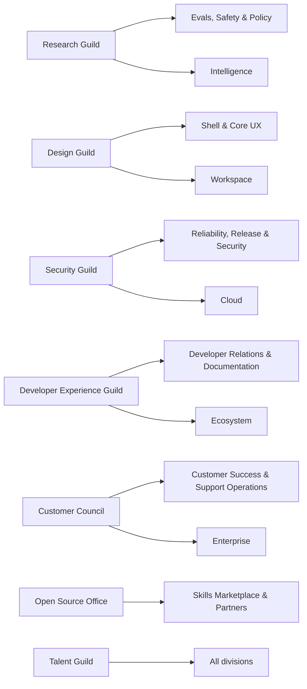

# Rox Workstream & Talent Blueprint

**Date:** 22 November 2026  
**Status:** Working blueprint for review. No product code is changed by this document.  
**Scope:** Rox desktop, hosted cloud, enterprise delivery and ecosystem.  
**Sources:** official job boards read on 22 November 2026; Rox repository at `feat/cloud-byok`; Rox planning documents listed in Appendix A.

---

## 0. One-page summary

Rox sells two transitions: **a person with an idea gets a working cloud machine in minutes**, and **their sessions, knowledge and agent stay in one desktop workspace**. The five divisions exist to make those two transitions repeatable.

Rox is no longer one product with one team. It is five products sharing one runtime:

1. **Intelligence** — the agent, its memory, its tools and its safety.
2. **Workspace** — the desktop and web surfaces where a person works with the agent.
3. **Cloud** — metered, secure machines that run agent work outside the laptop.
4. **Enterprise** — forward-deployed delivery, compliance and sovereignty.
5. **Ecosystem** — docs, SDKs, skills, partners and community.

The hiring market says the scarce roles are not generic managers. They are people who can own an applied AI outcome, a systems primitive, a security boundary, or a product surface end to end. Pure sales capacity is abundant; applied AI, forward deployment, infrastructure, security and developer experience are where the five anchor companies are actually hiring.

This blueprint therefore proposes:

- **5 divisions**, each with a clear mission and a small leadership core.
- **15 groups**, each with a measurable outcome and 2 claimable frontier tasks.
- **30 frontier tasks**, each with a source, an acceptance check and a named role family.
- **7 guilds** for extracurricular work that creates support and synergy effects without becoming a second organization.
- **A seed crew of 15–20 people** (founder plus five division leads plus ten group stewards) and a scale path to 35–45.
- **A 90-day sequence** that starts with cloud account isolation, payments, durability, multimodal turns, roadmap conflict recovery, one enterprise design partner and a tested quickstart.

The rest of this document explains the demand evidence, the structure, the tasks, the operating model, the hiring map and the acceptance checks.

---

## 1. The demand map: what the market is actually buying

### 1.1 Method and limits

I read the official job boards for the twelve companies named in the request on **22 November 2026**. The counts below are **public postings**, not unique headcount: one role can appear in several locations, and one person can fill several postings. Department counts come from the company's own board taxonomy. Recency uses the board's first-published date where it exists.

I chose **five anchor companies** with the most transferable signal for Rox:

- **Anthropic** — safety-first frontier lab.
- **OpenAI** — scaled AI product and platform company.
- **Thinking Machines** — small research lab with a strong systems core.
- **Palantir** — enterprise and government forward deployment.
- **Vercel** — AI cloud and developer platform.

The other seven are **adjacent signals**, not ignored:

- **Modal** — sandbox and inference infrastructure.
- **Nebius** — GPU cloud, infrastructure and agentic search.
- **Slack** — collaboration product and enterprise communication.
- **Substack** — creator monetization and content community.
- **Zed** — small-team editor and cloud backend.
- **SpaceX** — hardware, manufacturing and vertical integration.
- **Terafab** — Tesla/SpaceX chip fab hiring, visible through SpaceX and Tesla boards.

The reason for the split is simple: five anchors give a readable map. Seven more companies give context without turning the blueprint into a job-board dump.

### 1.2 Anchor companies at a glance

| Anchor | Open postings | Posted last 30 days | Posted last 90 days | The signal for Rox |
|---|---:|---:|---:|---|
| **OpenAI** | 852 | 292 | 571 | Applied AI and forward deployment are now as real as research. Security is a standalone function. |
| **Anthropic** | 635 | 171 | 391 | Safety, security and applied AI are operating functions, not appendices. Infrastructure is separate from product engineering. |
| **Thinking Machines** | 58 | 15 | 41 | A small lab can be research-heavy and systems-heavy at the same time. Product management is small but present. |
| **Palantir** | 308 | 22 | 48 | Forward deployment is a career path, not a sales overlay. Legal and information security scale with enterprise delivery. |
| **Vercel** | 86 | 18 | 43 | Infrastructure primitives get their own product managers. Agent auth, AI gateway, compute, storage and observability are product areas. |

### 1.3 What each anchor is hiring for

#### OpenAI — 852 postings

| Department | Postings | What it means |
|---|---:|---|
| Go To Market | 199 | The company is scaling distribution, not just research. Rox should not copy this ratio at seed. |
| Applied AI | 125 | Customer-facing AI engineering is a large, named function. |
| Scaling | 85 | Inference, compute and reliability are a first-class engineering org. |
| Research | 57 | Frontier research continues alongside product. |
| User Operations | 55 | Support and user operations scale with usage. |
| Marketing | 45 | Category creation is a real budget line. |
| Forward Deployed Engineering | 42 | A separate deployment career path, not a temporary sales engineer. |
| Security | 35 | Security is an operating org with its own headcount. |
| People / Finance | 24 / 24 | The company is building the boring functions. |
| Consumer Devices / Robotics | 19 / 17 | Hardware is a different labor market. |
| OpenAI for Gov | 14 | Regulated deployment is a distinct business. |

**What to copy:** applied AI plus forward deployment as one customer-facing ladder; a named security org; separate scaling/infrastructure ownership.  
**What not to copy:** 199 GTM postings before Rox has repeatable revenue; a consumer-device or robotics org.

#### Anthropic — 635 postings

| Department | Postings | What it means |
|---|---:|---|
| Sales | 122 | Enterprise demand is being built aggressively. |
| AI Research & Engineering | 71 | Research and engineering are one org, not two castles. |
| Applied AI | 70 | Customer-facing applied AI is as large as research. |
| Engineering & Design — Product | 53 | Product engineering and design are combined. |
| Security | 51 | Security is bigger than safeguards alone. |
| Finance | 40 | The company is preparing for scale and scrutiny. |
| Software Engineering — Infrastructure | 39 | Infrastructure is a separate engineering discipline. |
| Safeguards (Trust & Safety) | 32 | Safety is an operating function with its own headcount. |
| Compute | 25 | Compute capacity is a named team. |
| Technical Program Management | 24 | Cross-org delivery is a real function. |
| Product Management, Support & Operations | 17 | Product management is smaller than engineering. |
| Legal / People / Marketing | 17 / 16 / 16 | The supporting org is being built. |
| Public Policy | 14 | Policy is a real function for a frontier lab. |
| Data Science & Analytics | 10 | Analytics is present but not bloated. |
| Technical Education | 3 | Education is small but strategic. |

**What to copy:** safeguards and security as operating functions; applied AI as a peer of research; infrastructure as a separate discipline.  
**What not to copy:** 122 sales postings at Rox's current stage; a large public-policy org before regulated revenue.

#### Thinking Machines — 58 postings

| Department | Postings | What it means |
|---|---:|---|
| Core Engineering | 19 | Sandboxing, inference, data infrastructure, distributed systems, supercomputing, systems generalists. |
| Research | 14 | General agents, audio, vision, safety, RL scaling, post-training evals, coding agents, pre-training data. |
| Operations | 7 | Recruiting, people operations, executive support. |
| Research Infrastructure | 5 | Numerics, inference, training systems, kernels, web crawling. |
| Security & IT | 5 | Security engineering, privacy and data governance, GRC. |
| Product Management | 4 | Product manager, research product manager, data partnerships. |
| Policy / Design / Finance | 2 / 1 / 1 | Small supporting functions. |

**What to copy:** research infrastructure as a named group; sandboxing as a core engineering problem; a small product-management layer that sits close to research.  
**What not to copy:** supercomputing and custom training hardware.

#### Palantir — 308 postings

| Team | Postings | What it means |
|---|---:|---|
| Dev | 94 | Core software engineering for the platform. |
| Delta | 60 | Forward-deployed engineers who sit with customers. |
| Echo | 25 | Product development and applied delivery. |
| Legal | 22 | Enterprise and government contracting is legal-heavy. |
| Information Security | 19 | Security scales with deployment. |
| Finance | 17 | The company runs a real enterprise finance org. |
| Business Development | 15 | Partner and government channels. |
| Design | 13 | Design is a real function, not a contractor. |
| Product Development | 11 | Product engineering is separate from Delta. |
| Engineering | 6 | A smaller core engineering team. |
| Recruiting | 6 | Hiring is a named function. |
| Global Security | 5 | Physical and global security. |
| Mission Operations | 3 | Deployment operations. |

**What to copy:** Delta as a named forward-deployed career path; legal and information security as first-class enterprise functions; deployment strategists who own outcomes, not tickets.  
**What not to copy:** defense-heavy legal and global-security overhead before Rox has regulated customers.

#### Vercel — 86 postings

| Department | Postings | What it means |
|---|---:|---|
| Engineering | 17 | Agent auth, AI gateway, agentic infrastructure, backend, CDN, compute, runtimes, scheduled tasks, trust and safety, website. |
| Account Executive | 13 | Sales is the largest single named department. |
| Marketing | 8 | Category and field marketing. |
| Security R&D | 6 | Security is a product area, not only a cost center. |
| Product | 6 | Product managers for Compute, Dashboard, Networking + CDN, Observability, Software Factory, Storage. |
| Professional Services | 5 | Deployment help is a named function. |
| People / Partnerships | 5 / 5 | Supporting org and partner channel. |
| Solution Architects | 4 | Pre-sales technical design. |
| Field Readiness | 4 | Sales enablement. |
| Sales Development | 3 | Outbound pipeline. |
| Controllership / Legal | 3 / 2 | Finance and legal are present. |
| Support / Security G&A / IT / Finance / Design | 1 each | Small supporting functions. |

**What to copy:** one product manager per infrastructure primitive; agent auth and AI gateway as named product areas; a small professional-services function that feeds product.  
**What not to copy:** CDN and edge-network depth; a 13-person account-executive layer at Rox's stage.

### 1.4 Adjacent signals

| Company | Postings | What is notable | What Rox should take |
|---|---:|---|---|
| **Modal** | 52 | Engineering 24 (systems, ML performance, SDK, product backend, platform, inference, storage, machines); GTM 16 (DevRel, account executive, solutions architect, revenue operations); G&A 10; one documentation engineer. | Systems engineering, SDK ownership, forward-deployed ML, documentation as an engineering role. |
| **Nebius** | 367 | Infrastructure 71; Product & Infrastructure 37; Agentic Search 22; Network Infrastructure 16; Finance 15; Backend 15; System Engineers 11; ML 10; SRE 7; Solutions Architecture 4. | GPU/infrastructure depth, agentic search as a product, SRE as a named function. |
| **Slack** | 19 | Security software engineer, core services engineering manager, AI solution strategist, Android, research, data ingestion, content design, data scientist, backend enterprise productivity, product manager data products, data infrastructure, developer workspaces, VP product design, product data scientist. | Collaboration needs security, data and product design together; developer workspaces are a product. |
| **Substack** | 20 | Communications 6; Engineering 4 (payments, sponsorships, growth, video); Product 2 (payments, sponsorships); Partnerships 2; Data 1; Operations 1. | Monetization and creator success are product problems, not only marketing. |
| **Zed** | 2 | Backend engineer, cloud; designer. | A small team can keep cloud backend and design in-house. |
| **SpaceX** | 2,845 | Software 378; aerospace/mechanical 341; supply chain 235; electrical 191; sales/business operations 167; IT 110; EHS 105; manufacturing 93; facilities 86; security 84; silicon 78; HR 69. | Vertical integration and manufacturing discipline; not a role map for Rox. |
| **Terafab** | 5 (SpaceX board filter) | Global supply manager, capital equipment; operations engineer, EHS; construction safety; global supply manager, construction. | A bold capital project hires supply chain and safety before software. Not Rox's labor market. |

### 1.5 The seven conclusions that shape Rox

1. **Applied AI and forward deployment are a ladder, not a sales add-on.** OpenAI has 125 Applied AI and 42 Forward Deployed Engineering postings. Anthropic has 70 Applied AI. Palantir has 60 Delta. Rox needs a named forward-deployed path from day one, even if the first hires are generalists.
2. **Security and safety are operating functions.** Anthropic has 51 Security plus 32 Safeguards; OpenAI has 35 Security; Palantir has 19 Information Security. Rox cannot treat security as a review gate at the end.
3. **Infrastructure is a top-three engineering bucket at labs and the main bucket at infrastructure companies.** OpenAI Scaling 85; Anthropic SWE Infrastructure 39 plus Compute 25; Modal Engineering 24; Nebius Infrastructure 71 plus Product & Infrastructure 37. Rox Cloud needs its own systems, SRE and release ownership.
4. **Infrastructure primitives get their own product managers.** Vercel hires product managers for Compute, Storage, Observability, Networking + CDN and Software Factory. Rox should not hide cloud product decisions inside a single "platform PM".
5. **Developer experience is small but strategic.** Modal has a Documentation Engineer; Vercel has a DevRel Engineer, Agentic Infrastructure; Palantir has technical writers. Rox's 330-skill catalog and two SDKs need a real docs owner.
6. **Enterprise deployment is a distinct career path.** Palantir Delta 60; OpenAI FDE 42; Vercel Forward-Deployed Engineer plus Solutions Architects and Professional Services. Rox needs deployment engineers who can carry a customer outcome, not only support tickets.
7. **Hardware and space are a different labor market.** SpaceX's largest buckets are aerospace, supply chain, electrical and manufacturing; Terafab hires supply chain and safety. Use SpaceX as a lesson in vertical integration and operational discipline, not as a hiring template.

### 1.6 A second view: the shape of 1,939 anchor postings

Department counts are exact but coarse. A title-level cross-check of the same five anchor boards puts the set at **1,939 postings** and gives this shape:

| Role family | Postings | Share of anchor set |
|---|---:|---:|
| Forward-deployed and solutions | 343 | 17.7% |
| Infrastructure and SRE | 241 | 12.4% |
| Product engineering | 226 | 11.7% |
| Security, trust and policy | 177 | 9.1% |
| Research | 120 | 6.2% |
| Product management and design | 71 | 3.7% |
| Data and analytics | 36 | 1.9% |
| Developer relations, docs and education | 22 | 1.1% |
| GTM, operations and other | 703 | 36.2% |

The exact classification is debatable; the direction is not. **Customer-facing AI engineering is the largest named family, infrastructure is second, and security is fourth.** Generic management is not the scarce good. This is the strongest argument for making forward deployment a named ladder at Rox, not a task assigned to whoever is free.

### 1.7 What not to copy

- **Do not copy the GTM ratio.** OpenAI's 199 Go To Market and Anthropic's 122 Sales postings are signals of scale, not seed-stage design.
- **Do not copy the on-site policy.** Anthropic lists 548 on-site postings and Thinking Machines lists 58 on-site postings. Rox's advantage is a small, distributed, agent-assisted team.
- **Do not copy defense and government overhead.** Palantir's 22 Legal and 19 Information Security postings are proportional to regulated delivery. Rox should build the evidence pack before the cleared-staff org.
- **Do not copy hardware.** SpaceX and Terafab are useful for manufacturing discipline, not for Rox's org chart.
- **Do not confuse postings with headcount.** A company can post the same role in five locations. Use the counts as direction, not as a budget.

---

## 2. The workstream structure

### 2.1 Design rule

Every division must pass five tests:

1. **One customer outcome.** A person outside the company can name what improved.
2. **One shared contract.** The division owns at least one interface other divisions consume.
3. **One named consumer.** Another division or a real customer signs that the output is usable.
4. **One measurable frontier.** There is a task that can ship in 90 days and be checked without a slide.
5. **One kill condition.** If the outcome does not move in two quarters, the group can be merged or dissolved.

The structure is deliberately **five divisions, not fifteen**. Fifteen groups are enough granularity for ownership; five divisions are enough to keep the leadership room small.

### 2.2 The five divisions

```mermaid
flowchart TB
  CEO[Founder / CEO]
  CEO --> INT[Intelligence<br/>agent, memory, safety]
  CEO --> WRK[Workspace<br/>desktop and web surfaces]
  CEO --> CLD[Cloud<br/>sandboxes, identity, billing, reliability]
  CEO --> ENT[Enterprise<br/>forward deployment, compliance, support]
  CEO --> ECO[Ecosystem<br/>docs, skills, partners, community]

  INT --> INT1[Runtime & Sessions]
  INT --> INT2[Memory, Knowledge & Context]
  INT --> INT3[Evals, Safety & Policy]

  WRK --> WRK1[Shell & Core UX]
  WRK --> WRK2[Documents, Editor & Canvas]
  WRK --> WRK3[Collaboration & Communications]

  CLD --> CLD1[Sandboxes & Providers]
  CLD --> CLD2[Identity, Billing & Console]
  CLD --> CLD3[Reliability, Release & Security]

  ENT --> ENT1[Forward-Deployed Engineering]
  ENT --> ENT2[Solutions, Compliance & Sovereignty]
  ENT --> ENT3[Customer Success & Support Operations]

  ECO --> ECO1[Developer Relations & Documentation]
  ECO --> ECO2[Skills Marketplace & Partners]
  ECO --> ECO3[Content, Community & Education]
```



### 2.3 Division A — Intelligence

**Mission:** make the agent genuinely useful, safe and measurable on real work.

**Why this division exists:** the agent is the product's engine. If the runtime is unreliable, every surface looks broken. If memory is shallow, every session starts from zero. If safety is a review gate, the product cannot enter regulated work.

**Groups:**

| Group | Outcome | Core crew | Shared contract |
|---|---|---|---|
| **A1 Runtime & Sessions** | A turn starts, streams, tools, survives restart and fails in a typed, actionable way. | Agent runtime engineer, protocol engineer, QA automation | OMP session protocol, tool events, error codes |
| **A2 Memory, Knowledge & Context** | The agent remembers the right thing and can cite it. | Knowledge engineer, retrieval engineer, product engineer | Knowledge read/write contract, citation format |
| **A3 Evals, Safety & Policy** | Regressions are caught before users see them; unsafe actions fail closed. | Eval engineer, security engineer, policy lead | Eval suite, policy decision record, red-team corpus |

**Anchor evidence:** Anthropic AI Research & Engineering 71, Safeguards 32; OpenAI Research 57, Applied AI 125; Thinking Machines Research 14, Research Infrastructure 5, Security & IT 5.

**Interfaces:** A1 exposes the session protocol to Workspace and Cloud. A2 exposes retrieval and citation to Workspace and Enterprise. A3 reviews every division's risky changes and owns the red-team calendar.

### 2.4 Division B — Workspace

**Mission:** make Rox the best place to do knowledge work with an agent, on desktop and web.

**Why this division exists:** the agent is invisible without a surface. The workspace is where trust is won or lost: navigation, documents, code, canvas, meetings and sharing.

**Groups:**

| Group | Outcome | Core crew | Shared contract |
|---|---|---|---|
| **B1 Shell & Core UX** | A new user finds the next action without a tour; the app stays fast and accessible. | Product engineer, product designer, accessibility engineer | Navigation model, panel registry, design tokens |
| **B2 Documents, Editor & Canvas** | A document, code file or canvas survives edits, conflicts and export. | Editor engineer, canvas engineer, product designer | Document model, revision contract, export format |
| **B3 Collaboration & Communications** | A meeting, chat or shared session produces a durable outcome. | Collaboration engineer, integrations engineer, QA | Share capability, meeting transcript contract, messaging adapter |

**Anchor evidence:** OpenAI Core Product & Platform 9, Product Design 8, Consumer Devices 19; Vercel Product 6, Design 1; Slack product design, core services, data products; Substack product and growth; Zed designer.

**Interfaces:** B1 owns the shell that hosts A2 knowledge panels and C2 account panels. B2 owns the document and artifact model consumed by A2 and E3. B3 owns sharing and messaging contracts consumed by D3 and E1.

### 2.5 Division C — Cloud

**Mission:** turn agent work into durable, metered, secure machines that a customer can trust.

**Why this division exists:** the current `feat/cloud-byok` branch already has a real control plane: tenants, API keys, BYOK and managed billing, guest trials, encrypted provider keys, a Solid console, staff panel, support routes, TypeScript and Python SDKs, and Daytona/Modal/E2B adapters. The next frontier is not "build cloud"; it is "make cloud accountable".

**Groups:**

| Group | Outcome | Core crew | Shared contract |
|---|---|---|---|
| **C1 Sandboxes & Providers** | A machine starts, runs, stops and is billed the same way on every supported provider. | Systems engineer, provider engineer, SRE | Sandbox provider contract, capability matrix, conformance suite |
| **C2 Identity, Billing & Console** | The right person sees the right tenant, balance and invoice. | Identity engineer, billing engineer, product manager | Tenant/account model, key scopes, ledger contract |
| **C3 Reliability, Release & Security** | The control plane survives a restart, a bad deploy and a dependency alert. | SRE, security engineer, release engineer | State schema, backup/restore runbook, release gate |

**Anchor evidence:** Vercel Engineering 17 (agent auth, AI gateway, agentic infrastructure, compute, runtimes, storage, observability), Security R&D 6, Product 6 (Compute, Storage, Observability, Networking, Software Factory); Modal Engineering 24; Nebius Infrastructure 71, Product & Infrastructure 37, SRE 7; OpenAI Scaling 85; Anthropic SWE Infrastructure 39, Compute 25.

**Interfaces:** C1 exposes the sandbox contract to A1 and B3. C2 exposes account, key and invoice contracts to B1 and D3. C3 owns the release gate that every division passes through.

### 2.6 Division D — Enterprise

**Mission:** put Rox inside a real organization and make it survive procurement, security review and daily use.

**Why this division exists:** enterprise is not a bigger version of self-serve. It needs a deployment engineer, a compliance evidence pack, a support promise and a named customer owner. Palantir's Delta and OpenAI's Forward Deployed Engineering are the clearest market proof.

**Groups:**

| Group | Outcome | Core crew | Shared contract |
|---|---|---|---|
| **D1 Forward-Deployed Engineering** | A design partner reaches a real workflow in two weeks and expands it. | Forward-deployed engineer, solutions architect, integration engineer | Deployment playbook, integration adapter kit |
| **D2 Solutions, Compliance & Sovereignty** | A security questionnaire gets evidence, not promises; a deployment profile is real. | Compliance lead, security architect, legal counsel | Control matrix, data-flow ledger, deployment profile |
| **D3 Customer Success & Support Operations** | A customer gets a named owner, a response time and a fix. | Customer success lead, support engineer, operations analyst | Ticket schema, SLA, incident runbook |

**Anchor evidence:** Palantir Delta 60, Dev 94, Echo 25, Legal 22, InfoSec 19; OpenAI Applied AI 125, Forward Deployed Engineering 42, OpenAI for Gov 14; Anthropic Applied AI 70, Sales 122; Vercel Professional Services 5, Solutions Architects 4, Forward-Deployed Engineer 2.

**Interfaces:** D1 consumes C1/C2 and B3. D2 consumes C3 and legal. D3 consumes C2 support routes and feeds product issues back to A/B/C.

### 2.7 Division E — Ecosystem

**Mission:** make Rox extensible, legible and community-driven, so another person can succeed without the founder.

**Why this division exists:** Rox already ships 330 skills in 34 packs, two cloud SDKs, an OpenAPI surface and a cookbook effort. Without a docs and partner owner, those assets stay invisible.

**Groups:**

| Group | Outcome | Core crew | Shared contract |
|---|---|---|---|
| **E1 Developer Relations & Documentation** | A new developer ships a working Rox integration from the docs in under 15 minutes. | Developer relations engineer, technical writer, SDK engineer | Quickstart contract, SDK version policy, changelog |
| **E2 Skills Marketplace & Partners** | A skill or partner integration is verified, installable and supported. | Marketplace product manager, partner engineer, security reviewer | Skill manifest, verification checklist, partner certification |
| **E3 Content, Community & Education** | A user can learn Rox from a recipe, a course or another user. | Content lead, community manager, educator | Recipe format, case-study template, community code |

**Anchor evidence:** Vercel DevRel Engineer, Agentic Infrastructure, Professional Services, Partnerships; Modal Developer Relations Engineer, Documentation Engineer, Solutions Architect; Palantir Technical Writer 3; Substack Communications 6, Partnerships 2; Slack Developer Workspaces; Zed small-team design.

**Interfaces:** E1 consumes every division's public surface and owns the release notes. E2 consumes A3 security review and C2 key scopes. E3 consumes D3 customer stories and B2 artifacts.

### 2.8 Division-to-anchor map

| Division | Primary anchors | Secondary anchors | What the market justifies |
|---|---|---|---|
| **Intelligence** | Anthropic, OpenAI, Thinking Machines | Modal (inference) | Research, applied AI, evals, safety, runtime. |
| **Workspace** | OpenAI, Vercel, Slack | Substack, Zed | Product engineering, design, collaboration, editor. |
| **Cloud** | Vercel, Modal, Nebius | OpenAI, Anthropic | Systems, SRE, identity, billing, provider conformance. |
| **Enterprise** | Palantir, OpenAI, Anthropic | Vercel | Forward deployment, compliance, support, sovereignty. |
| **Ecosystem** | Vercel, Modal, Palantir | Substack, Slack, Zed | DevRel, docs, partners, content, community. |

### 2.9 Shared contracts between divisions

| Contract | Owner | Consumers | What must never break |
|---|---|---|---|
| OMP session protocol and tool events | A1 | B1, B2, C1 | A typed error, a terminal event and a restart-safe session. |
| Knowledge citation format | A2 | B2, D1, E1 | A citation points to the exact document revision the answer used. |
| Panel registry and design tokens | B1 | A2, C2, E2 | A panel can be added without forking the shell. |
| Document revision contract | B2 | A2, B3, E3 | No silent overwrite; a conflict is visible. |
| Share capability | B3 | D3, E1 | Only the owner can mutate a share. |
| Sandbox provider contract | C1 | A1, B3, D1 | Same create/exec/stop/delete semantics; explicit capability gaps. |
| Tenant and key scopes | C2 | B1, D1, D3 | Cross-tenant reads and writes are denied by default. |
| Release gate | C3 | All divisions | No artifact ships without a reproducible build and a security check. |
| Deployment playbook | D1 | D2, D3, E1 | A deployment is repeatable, not a hero story. |
| Control matrix | D2 | D1, D3, C3 | Every security claim has an evidence owner. |
| Skill manifest | E2 | A1, B1, D1 | A skill declares its permissions and can be removed cleanly. |

---

## 3. The 30 frontier tasks

**Read this first: the branch is ahead of the planning documents.** `plans/problem-inventory.md` still marks several rows OPEN that are implemented on `feat/cloud-byok`: the first-run credential seam (`packages/shared/src/agent/omp-first-run.ts` and 20 tests), the provider factory (`getAvailableProviders()` now returns `['anthropic', 'pi', 'omp']`), config-default parity, the share byte/nosniff fix, and the OAuth callback escaping. Before claiming a task, check the named path. The tasks below survive because the end-to-end proof, the second consumer, the cleanup or the money path is still missing.

Each task is written to be claimed by one group and checked without a slide. The "Why now" column points to the Rox path, plan or measured gap that makes the task current. The "Depends" column names only real blockers; a task with no blocker can start now.

### 3.1 Intelligence tasks

| ID | Frontier task | Why now | Role families | Acceptance | Depends |
|---|---|---|---|---|---|
| **INT-01** | Make multimodal attachments a first-class OMP turn | `packages/shared/src/agent/omp-agent.ts:2415` still appends textual references for attachments; the wire contract for images is not exercised. | Agent runtime engineer, protocol engineer, QA automation | Attach a PNG and a PDF; both reach the model; the transcript shows a preview; restart preserves them; an automated round-trip test fails on the old tree. | — |
| **INT-02** | Prove the first-turn path end to end and close the last gap | The credential seam exists in `packages/shared/src/agent/omp-first-run.ts` with 20 tests, but the full onboarding path and the clean-machine first turn are still not proven; `plans/problem-inventory.md §1.7` lists the row OPEN. | Agent runtime engineer, forward-deployed engineer, QA automation | An empty profile reaches either a real model answer or exactly one named credential step; no spinner; a retry succeeds with the credential; the path is idempotent and has a headless test from onboarding to first turn. | — |
| **INT-03** | Make Knowledge navigation real or remove it | `plans/problem-inventory.md §5.3` records Inbox, Daily, Databases and Tags as dynamic-empty; the inspector is mounted but the tree can look broken. | Knowledge engineer, product engineer, product designer | "Ask about this document" opens a session that still holds the document; the answer cites the exact revision; every empty state either lists real items or is removed. | — |
| **INT-04** | Make the Notes rail resolve old deep links or remove it | `plans/problem-inventory.md §5.7` records the rail ignoring the migration map: old `notes` deep links do not redirect to SiYuan ids; the proposal pipeline itself is already registered. | Knowledge engineer, product engineer, QA automation | An old `notes` deep link resolves to a SiYuan document id in a test, or the rail entry is removed and the test asserts its absence; no dead link remains. | INT-03 |
| **INT-05** | Build the agent red-team suite for browser, MCP, shell and preview ingress | `plans/problem-inventory.md` records SEC-01 (browser deep-link auto-send) and SEC-02 (client capability bypass to `shell:exec`); `infra/cloudflare/preview-worker.js:20-41` passes upstream redirects through, so a 302 can expose a vendor hostname; the guest limiter trusts a forwarded address. | Security engineer, eval engineer, QA automation | Ten attack cases run in CI: deep-link auto-send, shell capability bypass, MCP secret leak, OAuth callback injection, preview-proxy redirect leak, forged forwarded-for guest-limit bypass and four more; all fail closed; a negative control proves the test can fail. | — |
| **INT-06** | Write and enforce the provider data-flow ledger | `apps/cloud-api/README.md` and `docs/cloud-product-spec.md` define BYOK and managed modes, but there is no single ledger of what each provider sees and retains. | Policy lead, security engineer, backend engineer | One table covers every supported provider and mode; a retention switch is tested; no provider key or prompt body appears in logs; the ledger is linked from the console. | CLD-03 |

### 3.2 Workspace tasks

| ID | Frontier task | Why now | Role families | Acceptance | Depends |
|---|---|---|---|---|---|
| **WRK-01** | Make the unified-shell panels real or remove the flag | `apps/electron/src/renderer/atoms/unified-shell.ts:110` keeps the master flag off; `PanelHost.tsx` registers several panels (Knowledge, board, mail, conation) but they share renderers and the shell is still experimental. | Product engineer, product designer, accessibility engineer | At least three panels render distinct real content in classic and unified layouts; keyboard and focus pass; the flag default is recorded as a decision; a test mounts the real panels. | INT-03 |
| **WRK-02** | Pass a native accessibility and performance gate | `docs/roadmap-recovery.md` still lists keyboard, focus, narrow viewport and reduced motion as pending native gates. | Product engineer, accessibility engineer, QA automation | Ten installed-app scenarios pass: keyboard-only, focus order, 390px width, reduced motion, first paint, restart; screenshots and a trace are attached. | WRK-01 |
| **WRK-03** | Give the project roadmap a real conflict recovery | `docs/roadmap-recovery.md` records the compare/reload/merge affordance as pending; `ProjectInfoPage.tsx:253` currently shows an error and a reload button. | Product engineer, editor engineer, product designer | Two writers edit the same revision; the second sees a compare view; merge preserves both edits; no silent overwrite; a regression test fails on the old tree. | — |
| **WRK-04** | Make canvas output a durable artifact | `plans/canvas/PLAN.md` defines the canvas surface; the output is not yet a first-class artifact with provenance, reopen and export. | Canvas engineer, product engineer, product designer | An agent creates a canvas; the user edits it; it reopens after restart; export produces the same content; provenance names the session and model. | WRK-03 |
| **WRK-05** | Finish the meeting-agent loop | `plans/meeting-agents/PLAN.md`, `PRD.md` and `TESTS.md` define the meeting surface; the loop from transcript to durable action is not closed. | Collaboration engineer, integrations engineer, QA automation | A real 30-minute meeting fixture produces three actions with owner and date; the user approves; tasks are created; a rejection leaves no task. | — |
| **WRK-06** | Bring messaging workers to container parity | `plans/problem-inventory.md §9.8` records Docker/UI messaging drift; WhatsApp and Discord workers have different packaging assumptions. | Collaboration engineer, release engineer, QA automation | `docker compose` starts both workers; a message round-trips in each; reconnect works after a restart; a missing token fails with a typed, actionable error. | — |

### 3.3 Cloud tasks

| ID | Frontier task | Why now | Role families | Acceptance | Depends |
|---|---|---|---|---|---|
| **CLD-01** | Resolve the provider policy split and prove conformance | `packages/cloud-runner/src/public-registry.ts` allows only Daytona, local and native, while `apps/cloud-api/src/integration.ts` can resolve Modal and E2B behind environment flags; the site and catalog also read a static availability table; `capabilities.ts` claims Daytona `pause: true` while the `SandboxProvider` contract has no pause/resume method. | Systems engineer, provider engineer, SRE | One written policy says which providers are public, which are internal and why; the conformance suite passes for Daytona, Modal, E2B and local; one live machine per provider; catalog availability comes from live capability, not a static table; every capability flag matches an implemented method, and Daytona pause is implemented or set to false. | — |
| **CLD-02** | Make the machine workspace survive a restart | `apps/cloud-api/src/persistence.ts` already re-adopts leases, but the file, snapshot and terminal surfaces are not proven across a real restart; `scripts/cloud-smoke.sh` checks pages and routes but does not create a machine. | Systems engineer, backend engineer, QA automation | Write a file, create a snapshot, restart the API, and find the file and snapshot; the lease is re-adopted; the invoice matches; no orphan machine is billed; the smoke script creates, uses and deletes one machine. | CLD-01 |
| **CLD-03** | Replace API-key-only console access with real accounts and tenant isolation | `apps/cloud-api/src/auth.ts` verifies API keys only; `store.ts` has tenants but no user membership; `plans/identity-migration-plan.md` and the WEB-002 gate require isolated accounts. | Identity engineer, backend engineer, security engineer | Two users in two tenants log in; each sees only its machines and invoices; a cross-tenant request returns 403; revoking a key takes effect after restart; audit rows name the actor. | — |
| **CLD-04** | Add payments, invoices, dunning and provider reconciliation | `apps/cloud-web/src/routes/console/Invoice.tsx` shows a wallet and usage, but the repository has no payment provider, checkout, refund or failed-payment path; `packages/cloud-runner/src/reconciliation.ts` is exported but unused by `apps/`. | Billing engineer, product manager, data engineer | A test-mode payment tops up the wallet; an invoice is generated; a refund is recorded; a failed payment does not create credit; a monthly provider-invoice comparison reports drift in cents; the guest cannot mint balance. | CLD-03 |
| **CLD-05** | Move the control plane from one JSON file to a durable multi-instance store | `apps/cloud-api/src/persistence.ts` is explicitly one JSON file for a pilot; two instances cannot share it safely. | SRE, backend engineer, database engineer | Kill one instance; a second continues; the ledger stays balanced; a restore drill recovers tenants, keys, machines and invoices; 100 concurrent creates produce no double-spend. | CLD-03 |
| **CLD-06** | Make the release gate reproducible and verified | `docs/final-readiness/18-launch-status.md` records four open High Electron alerts and no final hosted release; `Dockerfile.server` and `scripts/desktop-release.ts` are the current release paths; `scripts/desktop-release.ts:90` still writes `signed: Boolean(CSC_LINK)`, a configuration claim rather than a signature check. | Release engineer, security engineer, SRE | A clean build produces an SBOM; no High dependency alert remains; the root typecheck checks every workspace or fails; the container builds on amd64 and arm64; `codesign --verify`, `spctl` and `stapler` results are recorded from the artifact; a failed signature blocks the release. | — |

### 3.4 Enterprise tasks

| ID | Frontier task | Why now | Role families | Acceptance | Depends |
|---|---|---|---|---|---|
| **ENT-01** | Deploy the first design partner in two weeks | `docs/cloud-product-plan.md` has a live-server acceptance path, but no named partner deployment; Palantir Delta 60 and OpenAI FDE 42 show the market expects a dedicated deployment role. | Forward-deployed engineer, solutions architect, integration engineer | One partner runs three real workflows daily for two weeks; the deployment takes under ten working days; a reusable playbook and a success scorecard exist. | CLD-02, CLD-03 |
| **ENT-02** | Ship the integration adapter kit | `plans/problem-inventory.md §6.2` records missing OAuth client IDs for Google, Slack and Microsoft; enterprise buyers expect these integrations. | Integration engineer, backend engineer, security engineer | Slack, Google and Microsoft each connect end to end; tokens are stored outside the renderer; a revoked token fails closed; docs cover setup and teardown. | CLD-03 |
| **ENT-03** | Build the security review evidence pack | `plans/compliance/component-decisions.json` preserves license decisions but has no control matrix; `docs/final-readiness/18-launch-status.md` lists open security and release gates. | Compliance lead, security architect, legal counsel | A 30-question customer security review gets evidence-backed answers for at least 90% of questions; an external reviewer signs the pack; every gap has an owner and a date. | CLD-05, CLD-03 |
| **ENT-04** | Decide and implement one enterprise deployment profile | The enterprise product choice is still open in the project record; `docs/ROX_CLOUD_CONNECT.md` describes the current connect path; Nebius and EU demand make residency a real question. | Solutions architect, SRE, legal counsel | A decision memo compares hosted, dedicated and air-gapped profiles on cost, latency, compliance and operations; one profile is implemented and tested; rollback is documented. | ENT-03 |
| **ENT-05** | Turn support into an SLA with an incident runbook | `apps/cloud-api/src/support.ts` already has ticket, incident and abuse stores; `Support.tsx` and `Status.tsx` exist, but there is no published response-time promise or on-call rotation, and `/v1/status` reports incidents rather than current machine and provider health. | Customer success lead, support engineer, SRE | Three simulated incidents meet the published severity and response times; the status page shows current machine and provider health, not only incidents; a postmortem is written; the on-call rotation is visible. | CLD-04 |
| **ENT-06** | Run a customer council and a renewal loop | `plans/next-program-spec.md` is full of user stories derived from internal pain; there is no standing external council to challenge the roadmap. | Customer success lead, product manager, operations analyst | Five design partners meet monthly; the top ten issues enter the roadmap with an owner; three ship within a quarter; a renewal health score exists. | ENT-05 |

### 3.5 Ecosystem tasks

| ID | Frontier task | Why now | Role families | Acceptance | Depends |
|---|---|---|---|---|---|
| **ECO-01** | Publish a cloud quickstart that works in 15 minutes | `packages/cloud-sdk-ts` and `packages/cloud-sdk-py` exist; `apps/cloud-web/src/routes/site/Docs.tsx` is a page, not a tested path from zero to a running machine; the product spec describes ten routes while OpenAPI describes forty-three; `apps/cli` has no cloud verbs. | Developer relations engineer, technical writer, SDK engineer | A fresh user follows the published quickstart with no edits and reaches a running machine and a file write in under 15 minutes; the docs test runs in CI; OpenAPI and the spec agree on the route set; the SDK or CLI can create, list and stop a machine. | CLD-02, CLD-04 |
| **ECO-02** | Start a monthly developer-content engine | Vercel hires a DevRel Engineer for Agentic Infrastructure; Modal hires a Developer Relations Engineer and a Documentation Engineer; Rox has no recurring public cadence. | Developer relations engineer, technical writer, product engineer | Three pieces publish each month (one tutorial, one demo, one changelog); each has a measurable call to action; signups and feedback are recorded. | ECO-01 |
| **ECO-03** | Verify the skill catalog and open a marketplace surface | `README.md` claims 330 skills in 34 packs; `apps/electron/resources/skills/REQUESTED-SKILLS.json` and `SKILLS.lock` exist, but there is no user-facing verification or removal path. | Marketplace product manager, security reviewer, product engineer | The top 50 skills are reviewed for permissions and dead dependencies; zero critical findings; install and uninstall work; a marketplace page lists verified and experimental tiers. | INT-05 |
| **ECO-04** | Certify three partner integrations | `plans/problem-inventory.md §6.2` records missing OAuth clients; Vercel and Modal both hire partner and solutions roles; Rox has no certification path. | Partner engineer, solutions architect, security engineer | Three partners pass a published certification checklist; each has an end-to-end test, a support contact and a public listing; a failed checklist blocks the listing. | CLD-03 |
| **ECO-05** | Ship ten tested Rox cookbook recipes | The cookbook effort exists in `plans/cookbooks-surface/PLAN.md` and the `2026-10-13-rox-cookbooks-notebooks` project; the recipes are not yet a tested, maintained set. | Content lead, product engineer, educator | Ten recipes cover agent workflows, cloud machines and enterprise setup; each runs in CI or a recorded fixture; each names prerequisites, cost and cleanup. | WRK-04 |
| **ECO-06** | Launch a community with a feedback loop | Substack has six communications roles and two partnership roles; Slack hires for developer workspaces; Rox has no standing community cadence. | Community manager, content lead, customer success lead | 100 active users, ten case studies and monthly office hours; at least 20 feedback items are triaged into the task board; a community code of conduct exists. | ECO-02 |

### 3.6 The parking lot: fourteen real tasks that should not start yet

These tasks are grounded and useful, but they are narrower than the first 30, blocked on a decision, or better after a foundation lands. They go on the board as `proposed`, not `ready`.

| ID | Parked task | Why it is parked | Role families | Acceptance when it starts |
|---|---|---|---|---|
| **P-01** | Finish the `SessionManager` seam and shrink the god module | `share-capability.ts`, `spawn-env.ts` and `turn-complete.ts` already exist beside `SessionManager.ts`, but the file is still 12,274 lines and 66 async methods; the prefactor is half-landed. It should finish before two groups edit sessions in the same month. | Runtime engineer, platform engineer | The extracted modules are used by the real call sites; the public RPC contract is unchanged; the file is under 10,000 lines; the session test list is identical before and after. |
| **P-02** | Stream partial tool output and make cancel honest | `plans/problem-inventory.md §1.11` records `tool_execution_update` as dropped. It is user-visible but less urgent than the first turn. | Runtime engineer, product engineer, designer | A 30-second command emits at least three partial updates; cancel stops within one second; the final output is not duplicated. |
| **P-03** | Make the root typecheck stop lying | The root `tsconfig.json` includes a `src/**/*` path that does not exist; `bun run typecheck` can pass without checking every workspace. | Platform engineer, release engineer | The root command prints the workspaces it checked or exits non-zero; a deliberate type error in `packages/core` is caught. |
| **P-04** | Remove the hardcoded POSIX shell on Windows | `apps/electron/src/main/handlers/system.ts:329` and `packages/server-core/src/handlers/rpc/system.ts:420` hardcode `/bin/zsh`; a Windows user cannot run a command. | Product engineer, platform engineer | The chosen shell is per platform; a Windows cold install opens a session and runs one command; a unit test asserts the policy. |
| **P-05** | Fuzz the share byte boundary and retire legacy shares | `apps/viewer/functions/s/_shared.ts:178` measures UTF-8 bytes; `apps/viewer/wrangler.toml` has no lifecycle rule for old shares. | Security engineer, platform engineer | A 500-iteration seed-stable fuzz accepts zero payloads over 25 MiB in UTF-8 bytes; a dry-run lists legacy objects; the lifecycle rule drives the count to zero. |
| **P-06** | Generate the anonymous endpoint census from code | Anonymous routes live in the viewer, the cloud API and the server transport; no single list classifies auth, rate limit and owner. | Security engineer, platform engineer | A committed table lists path, method, auth class, rate limit and owner; CI fails when a new route lacks a classification; a seeded route proves the failure. |
| **P-07** | Reconcile the ledger to the provider invoice | `packages/cloud-runner/src/reconciliation.ts` is exported but unused by `apps/`; there is no monthly drift report. | Data engineer, billing engineer | A script compares the ledger export with a provider invoice CSV; three known synthetic drifts are found exactly; the report is committed. |
| **P-08** | Verify signing from the artifact, not the environment | `scripts/desktop-release.ts:90` writes `signed: Boolean(process.env.CSC_LINK)`; a configured variable is not a verified signature. | Release engineer, security engineer | After a build, `codesign --verify`, `spctl -a -t exec` and `xcrun stapler validate` run; the manifest carries `signatureVerified`, `notarized` and `artifactSha256`; a tampered copy exits non-zero. |
| **P-09** | Census and remove dead surfaces | The tree still carries `dashboard.html` (19,045 bytes, unreferenced), residual `session-mcp-server`/`bridge-mcp-server` sources and unreferenced root pages; each one confuses users and agents. | Product engineer, platform engineer | One `plans/surface-census.md` row per surface with a path, proof of unreachability and a decision (mount, delete, keep until date); every "delete" becomes a task with an owner. |
| **P-10** | Rebuild the problem inventory with dates and evidence | `plans/problem-inventory.md` is partly historical; several rows marked OPEN are fixed on the current branch, and several fixed rows have no test path. | Technical program manager, data analyst | Every row has a verification date, a `file:line` or test name and a verdict; the count of corrected rows is recorded; no code changes are mixed into the inventory commit. |
| **P-11** | Fix the preview-proxy redirect leak and give the worker a test harness | `infra/cloudflare/preview-worker.js:20-41` passes upstream redirects through, so a 302 can expose a vendor hostname; `infra/cloudflare/` has no `package.json` and no tests for the only public ingress to customer machines. | Security engineer, platform engineer | A 302 from a fake upstream returns a `.rox.computer` location or a stripped location; a scan of headers and body finds no `daytonaproxy01`; tests cover bad label, reserved port, upstream 500, 404 and 200; `wrangler deploy --dry-run` parses. |
| **P-12** | Put automated tests under `cloud-web` and enforce the stated accessibility rules | `apps/cloud-web/package.json` has only `build` and `typecheck`; about 45 route files have no DOM tests; `docs/cloud-product-spec.md:151` requires labels, visible focus, keyboard and 4.5:1 contrast, but nothing checks them. | Product engineer, designer, QA automation | One DOM test per critical screen (configurator total, machine reserve/cost, guest key in `sessionStorage` only, kill switch); axe finds zero serious or critical issues on `/`, `/console`, `/console/machines/:id` and `/admin`; a keyboard-only run reaches run → terminal → stop. |
| **P-13** | Version and rotate the encrypted provider-key vault | `packages/cloud-keys/src/crypto.ts` uses AES-256-GCM with a single master key and no version field; replacing the master key makes every stored provider secret unreadable. | Security engineer, backend engineer, SRE | The envelope carries a key version; old secrets decrypt with the previous key during rotation; a rotate command re-encrypts every secret and reports the count; an unknown version fails closed; a wrong key produces a typed error, not a crash. |
| **P-14** | Replace the single staff key with scoped staff access and a durable request log | `apps/cloud-api/src/admin.ts:70` uses one `ROX_ADMIN_KEY`; the request journal is a 500-line in-memory ring; every staff action with the key has the same power. | Security engineer, backend engineer, SRE | Four roles (viewer, support, finance, superadmin) with least privilege; every staff action writes a durable audit row with actor and reason; the request log survives a restart; a viewer cannot rotate a key or move money; tests cover each denial. |

---

## 4. Work structure: how a task becomes done

### 4.1 The unit of work is a task card, not a job title

A job title describes a person. A task card describes an outcome. Rox needs both, but the task card is what gets claimed, reviewed and demonstrated.

Every task card has these fields:

```yaml
id: CLD-03
title: Replace API-key-only console access with real accounts and tenant isolation
division: Cloud
group: Identity, Billing & Console
why_now: >
  apps/cloud-api/src/auth.ts verifies API keys only; store.ts has tenants
  but no user membership; WEB-002 requires isolated accounts.
outcome: >
  Two users in two tenants can log in, see only their own machines and
  invoices, and lose access when a key is revoked.
acceptance:
  - two users in two tenants log in
  - a cross-tenant request returns 403
  - revoking a key takes effect after restart
  - an audit row names the actor
evidence:
  - test log
  - browser recording
  - audit row export
roles:
  - identity engineer
  - backend engineer
  - security engineer
depends_on:
  - none
reviewer: independent security reviewer
consumer: Workspace and Enterprise
claim_window: 14 days
status: ready
```

The card is deliberately short. If it needs a ten-page specification, the task is not ready; it is a project.

### 4.2 Roles and decision rights

| Role | Owns | Can decide alone | Must consult | Cannot do |
|---|---|---|---|---|
| **Division lead** | Mission, scope, staffing, budget, interfaces | Which tasks enter the division; who stewards a group | Founder on headcount and irreversible changes; consumers on interface changes | Change another division's contract; bypass security review |
| **Group steward** | Group outcome, task queue, acceptance | Task readiness, reviewer assignment, claim approval | Division lead on scope; consumer on interface | Accept a task without evidence; claim a task themselves and review it |
| **Task claimant** | One task, its evidence and its demo | Implementation details inside the agreed scope | Group steward on scope; reviewer on acceptance | Change a shared contract without the owner; merge without review |
| **Independent reviewer** | Technical or security correctness | Block a task | Group steward on scheduling | Be the claimant; waive a failing check |
| **Consumer** | The interface they consume | Reject an interface that breaks their use | Owner on timing | Change the owner's implementation |
| **Founder / sponsor** | Company direction, capital, irreversible bets | New division, new headcount, new market | Division leads; finance; legal | Micro-manage task acceptance |

The rule is simple: **the person who does the work does not accept the work.** At seed, the group steward can review a claimant's task only if the steward is not the claimant. If the group has one person, the division lead reviews.

### 4.3 The claim process

1. **Pick a Ready task.** The task must have a source, an outcome, an acceptance check, a named reviewer and no unresolved product decision.
2. **Write a five-line plan.** What will change, what will not change, how it will be checked, what could break, and when the demo will happen.
3. **Name the reviewer and the consumer.** A task without a reviewer is not claimable.
4. **Claim for 10 days.** The task board shows the claimant, the reviewer and the demo date. A task nobody claims in 10 days goes to the Monday auction: re-scope it to one day or kill it. Killing is a success because it removes work nobody believes in.
5. **Update weekly in one line.** Moved, blocked, or learned. No status meeting.
6. **Demo the acceptance.** Show the real surface: a test, a screen, a log, a customer outcome. Slides are not evidence.
7. **Accept or return.** The reviewer accepts, returns with a specific gap, or blocks with a named risk. A returned task keeps its evidence and gets a new date.

A claim that produces no update for seven days is released. A task that is blocked for 14 days is split or returned to the group steward.

### 4.4 Definition of Ready

A task is Ready only when all six are true:

1. **Source evidence exists.** A path, a test, a customer quote, a log or a measured gap.
2. **The outcome is one sentence.** A person outside the group can repeat it.
3. **The acceptance is observable.** A command, a screen, a file or a customer action.
4. **The scope boundary is written.** What will not change is as important as what will.
5. **The reviewer is named.** Independent of the claimant.
6. **The dependencies are resolved or named.** No hidden "wait for the platform" clause.

### 4.5 Definition of Done

A task is Done only when all seven are true:

1. **Acceptance evidence is attached.** The exact command, screenshot, log or customer record.
2. **The narrowest check passes.** The test that exercises the change, not the whole suite.
3. **The negative control fails.** The test can fail on the old tree; otherwise it proves nothing.
4. **The docs or changelog are updated** when a public surface changed.
5. **Rollout and rollback are written** for a cloud, security or data change.
6. **The consumer signs** when an interface changed.
7. **The demo is recorded** in the task card, not only in a chat.

### 4.6 Cadence

| Ritual | Frequency | Duration | Output |
|---|---|---|---|
| **Division frontier review** | Weekly | 30 min | One metric moved, one blocker, one decision. |
| **Task demo** | Weekly | 45 min | One accepted task with evidence; one returned task with a gap. |
| **Interface review** | Monthly | 60 min | Every shared contract has an owner, a consumer and a test. |
| **Strategy review** | Monthly | 90 min | Demand refresh, hiring plan, kill list, budget. |
| **Re-org review** | Quarterly | 2 hours | Groups graduate, merge or dissolve; divisions stay at five. |

The weekly demo is the most important ritual. It is where the organization learns whether a task is real. A task that cannot be demonstrated is not done, even if the code compiles.

### 4.7 Capacity model

**Seed crew (months 0–3): 15–20 people.**

- Founder / CEO.
- Five division leads (can double as group stewards).
- Ten group stewards (some part-time).
- 30 tasks, but only **10 active at a time**.
- One task per person; two per group; no one owns three.
- Agents can carry research, tests, docs and repetitive checks, but a human owns acceptance.

**Scale crew (months 6–12): 35–45 people.**

- Five division leads.
- Fifteen group stewards.
- Two to four contributors per group.
- 30 frontier tasks plus 15 maintenance tasks.
- A small platform team for release, security and data.

**The WIP limit is the org design.** If 30 tasks are active at once with 15 people, nothing is reviewed and everything is half-done. The board must show a queue, not a wish list.

### 4.8 Task board fields and statuses

| Field | Meaning |
|---|---|
| `id` | Stable code: `INT-01`, `WRK-01`, `CLD-01`, `ENT-01`, `ECO-01`. |
| `division` / `group` | Where the task lives. One group owns it. |
| `why_now` | The source evidence. No generic "improve quality". |
| `outcome` | One sentence a customer or operator can see. |
| `acceptance` | A checklist of observable results. |
| `evidence` | Links to tests, screenshots, logs, customer records. |
| `roles` | Role families needed, not named people. |
| `depends_on` | Only real blockers; no "nice to have". |
| `reviewer` | Independent person who can block. |
| `consumer` | The division that consumes the interface, if any. |
| `claim_window` | 14 days by default. |
| `status` | `proposed`, `ready`, `claimed`, `in_progress`, `in_review`, `accepted`, `blocked`, `dropped`. |

### 4.9 Anti-fake-progress rules

1. **No evidence, no acceptance.** A status update is not evidence.
2. **No negative control, no test.** A test that cannot fail is a ritual.
3. **No consumer signoff, no interface change.** The owner cannot declare their own contract sufficient.
4. **No rollback, no irreversible change.** Cloud, data and security changes need a rollback path.
5. **No demo, no done.** The demo can be a recording, but it must show the real surface.
6. **No orphan task.** Every task has a group, a reviewer and a consumer or a customer.
7. **No silent scope growth.** A task that grows becomes a new task; the original closes or returns.

### 4.10 Interface review

Every shared contract in Section 2.9 gets a one-page interface note:

- What the contract promises.
- What it explicitly does not promise.
- Who owns it.
- Who consumes it.
- The test that proves it.
- The change process.

The interface note is reviewed monthly. A contract with no consumer is deleted. A contract with no test is a risk.

---

## 5. Extracurricular layer: seven guilds with a job

The guilds are not a second org chart. They are **cross-cutting communities of practice** that create support and synergy effects for the divisions. Each guild has one steward, a 10–20% time budget, a cadence and a public output. A guild that produces nothing for two quarters is dissolved.

| Guild | Purpose | Cadence | First output | Home division | Synergy effect |
|---|---|---|---|---|---|
| **Research Guild** | Keep evals and research taste sharp across the company. | Monthly paper club; monthly eval review. | One research note and one new eval case. | Intelligence (A3) | Better model choices, fewer regressions, external credibility. |
| **Design Guild** | Keep the product coherent as surfaces multiply. | Biweekly critique; quarterly design-system review. | One shipped component and one critique record. | Workspace (B1) | Less UI drift, faster onboarding, reusable patterns. |
| **Security Guild** | Turn security from a gate into a habit. | Monthly threat model; quarterly red team. | One threat model and a prioritized fix list. | Cloud (C3) | Fewer incidents, faster enterprise reviews, safer defaults. |
| **Developer Experience Guild** | Make the first hour with Rox work. | Monthly docs test; monthly SDK example. | One fixed quickstart and one tutorial. | Ecosystem (E1) | Faster activation, fewer support tickets, better community. |
| **Customer Council** | Put real customers in the roadmap conversation. | Monthly 90-minute council. | Top ten issues with owners; one case study. | Enterprise (D3) | Product-market fit, reference customers, renewal signal. |
| **Open Source Office** | Keep licenses, notices and upstream contributions clean. | Quarterly license review; quarterly upstream contribution. | One OSS release and one notice update. | Ecosystem (E2) | Ecosystem goodwill, legal safety, recruiting reach. |
| **Talent Guild** | Make hiring and onboarding repeatable. | Monthly calibration; quarterly onboarding review. | One scorecard and one 30-day onboarding plan. | People / operations | Better hires, faster ramp, less founder bottleneck. |

### 5.1 Guild rules

1. **One steward, not a committee.** The steward owns the calendar and the output.
2. **10–20% time.** A guild is extracurricular, not a hidden second job.
3. **No separate budget.** If a guild needs money, it submits a task to a division.
4. **One public output per quarter.** A note, a component, a fix, a case study or a release.
5. **Output feeds a task.** A guild output that no division consumes is a hobby.
6. **Quarterly demo.** The guild shows the output in the same demo as the divisions.
7. **Dissolve after two empty quarters.** The steward can restart it later.
8. **Own formats, gates and reviews, not source files.** A guild can define a receipt format, a design token or a threat-model template; it cannot become a hidden engineering team. A guild that merges nothing for three cycles is dissolved.

### 5.2 First 30 days for every guild

- Write a one-page charter: purpose, steward, members, cadence, output, home division.
- Pick one output for the first quarter.
- Put the output on the task board with an owner and an acceptance check.
- Book the first three sessions.
- Announce the guild in the weekly demo.

### 5.3 How the guilds connect to the divisions



---

## 6. Hiring map: which roles, in which order, for which task

### 6.1 The twelve role families

| Role family | What they own at Rox | Where they are core | Anchor evidence |
|---|---|---|---|
| **Research scientist / research engineer** | Evals, agent behavior, retrieval quality, model selection, safety research. | A3, A2 | Anthropic AI Research & Engineering 71; OpenAI Research 57; Thinking Machines Research 14. |
| **Agent / runtime engineer** | OMP session lifecycle, tool events, streaming, attachments, errors, restart. | A1 | Thinking Machines Core Engineering 19; OpenAI Applied AI 125; Anthropic AI Research & Engineering 71. |
| **Product engineer** | A user-facing surface end to end: UI, state, API, tests, performance. | B1, B2, C2, E1 | OpenAI Core Product & Platform 9 plus product engineering across departments; Vercel Engineering 17. |
| **Systems / infrastructure engineer** | Sandboxes, providers, storage, networking, scheduling, cost, reliability. | C1, C3 | Modal Engineering 24; Nebius Infrastructure 71 and Product & Infrastructure 37; OpenAI Scaling 85; Anthropic SWE Infrastructure 39 and Compute 25. |
| **Security / trust engineer** | Threat models, least privilege, secrets, supply chain, incident response, safety boundaries. | A3, C3, D2 | Anthropic Security 51 and Safeguards 32; OpenAI Security 35; Palantir Information Security 19; Vercel Security R&D 6. |
| **Product manager** | One primitive or journey, its evidence, its tradeoffs and its roadmap. | C2, B1, E2 | Vercel Product 6 (Compute, Storage, Observability, Networking, Software Factory); Anthropic Product Management 17; Thinking Machines Product Management 4. |
| **Product designer** | Interaction model, information architecture, accessibility, design system. | B1, B2 | OpenAI Product Design 8; Palantir Design 13; Vercel Design 1; Slack product design roles. |
| **Data / analytics engineer** | Product metrics, funnel, reliability data, billing reconciliation, experiments. | A3, C2, E3 | OpenAI Data Science 13; Anthropic Data Science 10; Palantir product data roles; Slack data scientist and data engineer roles. |
| **Forward-deployed engineer / solutions architect** | A customer outcome in the customer's environment; deployment, integration, debugging, expansion. | D1, D2 | Palantir Delta 60; OpenAI Applied AI 125 and Forward Deployed Engineering 42; Anthropic Applied AI 70; Vercel Forward-Deployed Engineer 2 and Solutions Architects 4. |
| **Developer relations / technical writer** | Quickstarts, SDK docs, tutorials, changelog, community education. | E1, E3 | Vercel DevRel Engineer, Agentic Infrastructure; Modal Developer Relations Engineer and Documentation Engineer; Palantir Technical Writer 3; Anthropic Technical Education 3. |
| **GTM / partnerships / customer success** | Pipeline, partner channel, customer health, renewals, case studies. | D3, E2, E3 | OpenAI Go To Market 199; Anthropic Sales 122; Palantir Business Development 15; Vercel Account Executive 13 and Partnerships 5; Substack Partnerships 2 and Creator Success. |
| **Operations / people / finance / legal** | Hiring, onboarding, finance, contracts, compliance operations, workplace. | All divisions; D2 | Anthropic Finance 40 and Legal 17; Palantir Legal 22 and Finance 17; OpenAI People 24 and Finance 24; Vercel People 5, Finance 6 and Legal 2. |

Two supporting families are not separate groups but are needed:

- **QA / automation engineer** — owns the negative controls, the CI fixtures and the installed-app checks.
- **Technical program manager** — owns cross-division delivery, dependency tracking and the release calendar.

### 6.2 Role-to-group matrix

| Group | Core roles | Supporting roles | First task |
|---|---|---|---|
| **A1 Runtime & Sessions** | Agent/runtime engineer, protocol engineer | QA automation, product engineer | INT-01 |
| **A2 Memory, Knowledge & Context** | Knowledge engineer, retrieval engineer | Product engineer, data engineer | INT-03 |
| **A3 Evals, Safety & Policy** | Eval engineer, security engineer, policy lead | Research scientist, data engineer | INT-05 |
| **B1 Shell & Core UX** | Product engineer, product designer | Accessibility engineer, QA automation | WRK-01 |
| **B2 Documents, Editor & Canvas** | Editor engineer, canvas engineer, product designer | Product engineer, QA automation | WRK-03 |
| **B3 Collaboration & Communications** | Collaboration engineer, integrations engineer | QA automation, security engineer | WRK-05 |
| **C1 Sandboxes & Providers** | Systems engineer, provider engineer | SRE, QA automation | CLD-01 |
| **C2 Identity, Billing & Console** | Identity engineer, billing engineer, product manager | Security engineer, designer | CLD-03 |
| **C3 Reliability, Release & Security** | SRE, security engineer, release engineer | Data engineer, QA automation | CLD-05 |
| **D1 Forward-Deployed Engineering** | Forward-deployed engineer, solutions architect | Integration engineer, product engineer | ENT-01 |
| **D2 Solutions, Compliance & Sovereignty** | Compliance lead, security architect, legal counsel | Solutions architect, technical writer | ENT-03 |
| **D3 Customer Success & Support Operations** | Customer success lead, support engineer | Operations analyst, product manager | ENT-05 |
| **E1 Developer Relations & Documentation** | Developer relations engineer, technical writer | SDK engineer, product engineer | ECO-01 |
| **E2 Skills Marketplace & Partners** | Marketplace product manager, partner engineer | Security reviewer, developer relations | ECO-03 |
| **E3 Content, Community & Education** | Content lead, community manager, educator | Product designer, customer success | ECO-05 |

### 6.3 First 10 hires (next 90 days)

These are ordered by the bottleneck they remove, not by seniority.

1. **Cloud identity / security engineer** — makes CLD-03 and CLD-06 real; without it, the cloud is a prototype with API keys.
2. **Cloud systems / SRE engineer** — owns CLD-01 and CLD-05; without it, every provider is a snowflake and every restart is an incident.
3. **Agent runtime engineer** — owns INT-01 and INT-02; the agent's reliability is the product's reliability.
4. **Product engineer, workspace** — owns WRK-01 and WRK-03; the shell and the roadmap are where users feel the product.
5. **Product designer** — owns the interaction model across B1/B2; without it, every surface invents its own pattern.
6. **Forward-deployed engineer** — owns ENT-01; the first design partner needs a person, not a support queue.
7. **Developer relations engineer / technical writer** — owns ECO-01; the SDKs and skills are invisible without a tested quickstart.
8. **Billing / payments backend engineer** — owns CLD-04; a wallet without payments is a demo.
9. **Product manager, cloud primitives** — owns the capability matrix and the pricing/packaging tradeoffs; Vercel's example shows one PM per primitive.
10. **Customer success / support lead** — owns ENT-05; the first paying customer needs a named owner and a response time.

### 6.4 Next 10 hires (months 4–6)

11. **Security / trust engineer** — expands INT-05 into a standing red-team and review function.
12. **Data / analytics engineer** — makes A3 and E3 measurable; without it, "better" is an opinion.
13. **Knowledge / retrieval engineer** — deepens A2 after the first knowledge surface ships.
14. **Collaboration / integrations engineer** — owns ENT-02 and B3; Slack, Google and Microsoft are enterprise table stakes.
15. **Release engineer** — owns CLD-06; reproducible builds and signed artifacts.
16. **Marketplace product manager** — owns ECO-03/ECO-04; the skill catalog needs a curator, not a folder.
17. **Content / community lead** — owns ECO-06; the community needs a cadence.
18. **QA automation engineer** — owns the negative controls across all divisions; this is the person who prevents fake green.
19. **Technical program manager** — owns cross-division dependencies and the release calendar.
20. **People / operations generalist** — owns hiring, onboarding and the Talent Guild.

### 6.5 Next 20 hires (months 7–12)

- Research / eval engineer (A3).
- SDK engineer (E1).
- Mobile engineer (B1/B3) if mobile is in scope.
- Design systems engineer (B1).
- Solutions architect (D1/D2).
- Compliance lead (D2).
- Legal counsel, commercial (D2).
- Finance / revenue operations (C2/D3).
- Support engineers (D3), two.
- Regional forward-deployed engineers (D1), two.
- Partner engineers (E2), two.
- Technical writers (E1), one.
- Community manager (E3), one.
- Sales / partnerships (D3/E2), only after repeatable revenue.
- Data engineer (C2), one.
- Platform security engineer (C3), one.
- Recruiter (Talent Guild), one.

### 6.6 Borrow, buy, build

| Need | Build | Buy / borrow | Why |
|---|---|---|---|
| Agent runtime, session protocol | Build | — | This is the product's core differentiation. |
| Cloud control plane, tenant model, metering | Build | — | The billing and isolation logic is the business. |
| Payments, tax, invoicing | Integrate | Stripe/Paddle or local equivalent | Commodity, regulated, high cost of error. |
| Identity / SSO | Integrate | WorkOS, FusionAuth or existing provider | Security-sensitive, well-served market. |
| Observability | Integrate | OpenTelemetry plus a managed backend | Do not build a metrics store. |
| Support desk | Integrate | Existing ticket system | The support schema is already in `apps/cloud-api/src/support.ts`. |
| Legal, compliance audit | Borrow | External counsel and auditor | Needed for enterprise, not a full-time team at seed. |
| Brand, video, event production | Borrow | Contractors | Project-based, not a core headcount. |
| Niche integrations | Borrow | Partner or open-source maintainer | Faster than hiring a specialist for one connector. |

### 6.7 Interview scorecards

Every role gets a four-part scorecard. The goal is evidence of work, not trivia.

| Role family | Must show | Strong signal | Red flag |
|---|---|---|---|
| **Research / eval** | A shipped eval or experiment with a failure analysis. | Can explain why a metric is misleading and what they changed. | Talks only about papers; no production or eval artifact. |
| **Agent / runtime** | A session, tool or streaming system they made reliable. | Can trace a failure across process, protocol and UI. | Blames the model for every failure. |
| **Product engineer** | An end-to-end surface with tests and a performance number. | Can simplify a messy flow without losing behavior. | Only component work; no ownership of state or API. |
| **Systems / infrastructure** | A stateful system with failure, recovery and cost analysis. | Can design a rollback before the feature. | Only happy-path diagrams; no incident story. |
| **Security / trust** | A threat model and a real finding they fixed. | Can say "no" with a cheaper alternative. | Checklist-only security; no exploit thinking. |
| **Product manager** | A primitive or journey they owned with evidence. | Can name what they killed and why. | Roadmap without numbers or customer evidence. |
| **Product designer** | A system, not a screen: interaction, states, accessibility. | Can defend a simpler flow with user evidence. | Portfolio-only; no shipped constraints. |
| **Data / analytics** | A metric definition and a decision it changed. | Can show a misleading metric they corrected. | Dashboards without decisions. |
| **Forward-deployed** | A customer deployment with an outcome. | Can debug in an unfamiliar environment and teach the customer. | Hero stories without a repeatable playbook. |
| **DevRel / writer** | A tutorial or SDK example that runs. | Can explain a hard concept in plain words. | Marketing copy without code. |
| **GTM / partnerships** | A pipeline or partner motion with numbers. | Can qualify out fast. | Logo collection without retention. |
| **Operations / finance / legal** | A process they made auditable. | Can show the failure they prevented. | "I kept the trains running" with no evidence. |

### 6.8 Levels

| Level | Scope | Proof |
|---|---|---|
| **Associate** | One task with a reviewer. | Acceptance evidence; no unresolved quality gap. |
| **Mid** | One task end to end, including tests and docs. | A consumer uses the result without help. |
| **Senior** | A group outcome or a multi-task program. | Two accepted tasks; one interface change with a consumer. |
| **Staff / lead** | A division contract or a cross-division program. | A measurable division metric moved; a repeated failure removed. |
| **Principal** | Company-level technical direction. | A contract adopted by two divisions; a risk retired. |

Titles are less important than the proof. A senior engineer who cannot show a consumer is a mid-level engineer with a better vocabulary.

### 6.9 Hiring sequence by quarter

| Quarter | Hires | Why |
|---|---|---|
| **Q4 2026 (now)** | First 5: cloud identity, cloud SRE, agent runtime, workspace product engineer, designer. | Unblock the cloud and the shell before adding sales. |
| **Q1 2027** | Next 5: FDE, DevRel/writer, billing, cloud PM, customer success. | Turn the cloud into a product a customer can buy and deploy. |
| **Q2 2027** | Next 10: security, data, knowledge, integrations, release, marketplace, community, QA, TPM, people ops. | Make the org repeatable and the ecosystem real. |
| **Q3–Q4 2027** | Next 20: scale the groups, add regional FDE, compliance, legal, finance, support. | Scale only after the first paying customers and the first repeatable playbook. |

---

## 7. The first 90 days

### 7.1 Weeks 1–2: name the owners and freeze the interfaces

- Name five division leads. At seed, the founder can lead one division, but not all five.
- Name fifteen group stewards. A steward can be part-time, but every group has one name.
- Put the 30 tasks and 14 parked tasks on the board from `task-board.json`.
- Mark the first ten as `ready`; everything else stays `proposed` until a steward makes it ready.
- Freeze the shared contracts in Section 2.9 for one quarter. Changes need the consumer's signoff.
- Charter the seven guilds: one steward, one output, three dates.
- Publish the decision rights and the 10-day claim rule.

**Exit check:** a stranger can open the board and answer "who owns this, who reviews it, what proves it" for any task.

### 7.2 Weeks 3–6: unblock the two transitions

Active tasks, six at a time:

1. **CLD-03** — real accounts and tenant isolation. This is the cloud's trust boundary.
2. **CLD-05** — durable multi-instance store. Without it, the cloud is a single process.
3. **INT-01** — multimodal attachments. The agent must see what the user sees.
4. **INT-02** — first turn reaches a real answer or one credential step. This is the onboarding promise.
5. **WRK-03** — roadmap conflict recovery. This is the first document workflow that must not lose data.
6. **ECO-01** — a quickstart that works in 15 minutes. This is the first external proof.

Run the weekly demo from week 3. The first demo should show one of these six, not a slide.

**Exit check:** at least two tasks accepted with evidence; the cloud has a tenant boundary; the first-turn path is honest; the quickstart is tested.

### 7.3 Weeks 7–12: turn the cloud into a product and the project into a team

Add:

7. **CLD-04** — payments, invoices, dunning, reconciliation.
8. **CLD-06** — reproducible, signed release.
9. **CLD-01** — provider policy and conformance.
10. **ENT-01** — first design partner in two weeks.
11. **ENT-03** — security review evidence pack.
12. **ECO-03** — skill catalog verification and marketplace surface.

Hire the first five roles from Section 6.3. Do not add sales until there is a repeatable paid path.

**Exit check:** one design partner runs a real workflow; one paying customer or a signed pilot; the release gate is green; the first five hires are onboarded with a 30-day plan.

### 7.4 Day 90 scorecard

| Area | Target | Evidence |
|---|---|---|
| **Structure** | 5 division leads, 15 group stewards, 7 guild stewards named. | Org page with names and dates. |
| **Board** | 30 tasks, 10 active, 10 accepted, 0 orphan tasks. | Board export and demo recordings. |
| **Cloud** | Tenant isolation, payments, durable store, signed release. | CLD-03/04/05/06 evidence bundles. |
| **Intelligence** | Multimodal turn and honest first turn. | INT-01/02 evidence bundles. |
| **Workspace** | Roadmap conflict recovery and one shell decision. | WRK-01/03 evidence bundles. |
| **Enterprise** | One design partner and one evidence pack. | ENT-01/03 customer record and reviewed pack. |
| **Ecosystem** | Tested quickstart and 50 verified skills. | ECO-01/03 evidence bundles. |
| **Hiring** | First five hires started; next five in process. | Offer letters and 30-day plans. |
| **Guilds** | Each guild has a charter and one output. | Guild charters and quarterly demo. |

### 7.5 Twelve-month view

- Five divisions at seed capacity; fifteen groups with two to four people each.
- Thirty frontier tasks, with a rolling ten active and ten accepted per quarter.
- Seven guilds with one public output per quarter.
- First ten paying customers or design partners; one repeatable deployment playbook.
- Three certified partners; one public marketplace surface.
- A hiring plan of 35–45 people, tied to revenue and task throughput, not to a vanity org chart.

---

## 8. Acceptance and evidence for this blueprint

This document is accepted when the following are true:

1. **The structure is real.** Five division leads and fifteen group stewards are named, with dates.
2. **The board is real.** `docs/workstreams/task-board.json` contains 30 frontier tasks and 14 parked tasks; every task has a source, role families, acceptance, dependency and reviewer.
3. **The dependencies are acyclic.** The validation script finds no cycle and no missing dependency.
4. **The interfaces are owned.** Every contract in Section 2.9 has an owner and a consumer.
5. **The guilds are chartered.** Seven guilds have a steward, a cadence and a first output.
6. **The first ten hires are mapped.** Each hire names the task or contract they unblock.
7. **The 90-day scorecard is scheduled.** The first review has a date and an owner.
8. **The evidence is external where possible.** A customer record, a test log, a signed artifact or a public page; not a status sentence.

The validation command is:

```bash
python3 docs/workstreams/validate_blueprint.py
```

The script checks counts, IDs, dependency integrity, group coverage, role-family coverage and the presence of an acceptance line for every task. It is intentionally simple: a blueprint that cannot pass a structural check is not ready to run.

### 8.1 What would falsify this blueprint

- **The first ten tasks all block on the same file.** Then the bottleneck is a module, not an org; fix the module before adding groups.
- **No customer will join the first design partner.** Then the Enterprise division is premature; keep D1 as a part-time forward-deployed function and merge D2/D3 into Cloud.
- **The cloud cannot isolate tenants without a rewrite.** Then stop hiring for Cloud and fix the tenancy model first; the rest of the cloud roadmap is fiction.
- **The guilds produce no output for two quarters.** Then dissolve them and keep only the Security and Customer Councils.
- **The first five hires cannot be found at the planned level.** Then narrow the roles to one primitive each and use contractors for the rest.

---

## 9. Risks, tradeoffs and non-goals

### 9.1 The ten risks that matter

| Risk | Why it happens | Mitigation | Cost of leaving it |
|---|---|---|---|
| **Org chart before product-market fit** | A ambitious plan creates departments to look serious. | Five divisions, fifteen groups, ten active tasks; a quarterly kill list. | Coordination cost with no revenue. |
| **Too many groups** | Every interesting problem becomes a group. | A group must have a consumer; no consumer, no group. | Meetings, unclear ownership, duplicate work. |
| **Hiring ahead of revenue** | The market map looks like a shopping list. | The first ten hires are tied to tasks; GTM hires wait for repeatable revenue. | Runway burn, layoffs, lost focus. |
| **Guilds become meetings** | Extracurricular work has no deadline. | Guilds own formats, not code; one output per quarter; dissolve after two empty quarters. | Calendar bloat, cynicism. |
| **Enterprise compliance drag** | A dedicated compliance team arrives before a customer. | Build the evidence pack with borrowed counsel; hire full-time after the first paid enterprise pilot. | Slow decisions, high cost. |
| **Cloud provider sprawl** | Every provider looks strategic. | One public registry, one conformance suite, explicit capability matrix. | Snowflake operations, billing errors, security gaps. |
| **Founder bottleneck** | Every decision escalates. | Decision rights: price, identity, brand, hiring and data deletion are the founder's; the rest is delegated. | Slow shipping, burned-out team. |
| **"Frontier task" becomes backlog** | A task is proposed but nobody claims it. | 10-day expiry; re-scope or kill; killing is a success. | A graveyard of good intentions. |
| **Fake green** | A test passes but does not exercise the change. | Negative control, consumer signoff, demo. | False confidence, regressions. |
| **One module serializes the org** | `SessionManager.ts` is 12,274 lines and every feature touches it. | Parked task P-01 before two groups edit sessions in the same month. | Parallel work collapses into a queue. |

### 9.2 Why functional groups, not a pure pod market

A pod market is attractive: small teams, clear numbers, fast killing. It is the right model when the bottleneck is prioritization. Rox's current bottleneck is **shared contracts**: the session module, the cloud tenancy model and the release path. A pure pod market would let three pods edit the same module and call it autonomy. The functional structure puts one owner on each contract, then uses pods inside a group for time-boxed tasks. If the first ten tasks show that the contracts are stable, a pod market becomes a good next step.

### 9.3 The cheapest disproof

Run the first ten tasks for two weeks with the real board, the real reviewers and no new hires. If three or more tasks block for more than a day on a file another group owns, or if more than half the claims come from the same three people, the structure is too coupled. Merge the groups that share the file and move the bottleneck to a platform group. Cost: ten people, ten days, zero new process.

### 9.4 Non-goals

- **No hardware.** No chips, no fabs, no robots. SpaceX and Terafab are a lesson in execution, not a product line.
- **No model training.** Rox uses providers; a research lab is a different company.
- **No 24/7 global support at seed.** A published severity matrix and a business-hours rotation are enough until there is a paying enterprise contract.
- **No SOC 2 immediately.** Build the evidence pack first; certify when a customer requires it.
- **No copying big-company ratios.** 199 GTM postings, 122 sales postings and 2,845 SpaceX postings are not a plan.
- **No second product line before the first repeatable revenue.** The five divisions share one runtime; a sixth division needs a new company.

---

## Appendix A. Sources and method

### A.1 Job boards read on 22 November 2026

| Company | Official board | Postings | Use |
|---|---|---:|---|
| OpenAI | `https://openai.com/careers/` (Ashby board `openai`) | 852 | Anchor |
| Anthropic | `https://www.anthropic.com/careers` (Greenhouse board `anthropic`) | 635 | Anchor |
| Thinking Machines | `https://jobs.ashbyhq.com/ThinkingMachines` | 58 | Anchor |
| Palantir | `https://www.palantir.com/careers/` (Lever board `palantir`) | 308 | Anchor |
| Vercel | `https://vercel.com/careers` (Greenhouse board `vercel`) | 86 | Anchor |
| Modal | `https://modal.com/careers` (Ashby board `modal`) | 52 | Adjacent |
| Nebius | `https://careers.nebius.com/` (Greenhouse board `nebius`) | 367 | Adjacent |
| Slack | `https://slack.com/careers` (Salesforce Workday `Slack`) | 19 | Adjacent |
| Substack | `https://substack.com/careers` (Ashby board `substack`) | 20 | Adjacent |
| Zed | `https://zed.dev/jobs` (Ashby board `zed`) | 2 | Adjacent |
| SpaceX | `https://www.spacex.com/careers/` (Greenhouse board `spacex`) | 2,845 | Adjacent |
| Terafab | `https://terafab.ai/`; roles appear on the SpaceX board and Tesla careers | 5 on the SpaceX board | Adjacent |

### A.2 Method

- Counts are **public postings**, not unique headcount. One role can appear in several locations.
- Department counts come from the company's own board taxonomy. Where the board does not expose a department, the count uses the embedded category or the board's department endpoint.
- Recency uses `publishedAt` (Ashby), `first_published` (Greenhouse), `createdAt` (Lever) or the Workday posted date. "Last 30 days" means on or after 23 October 2026; "last 90 days" means on or after 24 August 2026.
- The role-family cross-check in Section 1.6 is a title-level classification of the five anchor boards. It is directional, not a payroll census.
- The demand summary is stored in `docs/workstreams/open-roles-summary-20261122.json`; it contains totals, department counts and representative titles, not full posting bodies.
- No applicant data, no personal data and no compensation data were collected.

### A.3 Rox sources read

- `README.md` — product surfaces, skills, release matrix.
- `CONTEXT.md` — workspace terminology and performance invariants.
- `plans/next-program-spec.md` — first-run, knowledge, secrets, identity and shell decisions.
- `plans/problem-inventory.md` — current and historical defects, with status and file references.
- `plans/remediation-board.md` — workstream tracker and integration state.
- `docs/roadmap-recovery.md` — persistence, conflict and native acceptance gates.
- `docs/cloud-product-plan.md` and `docs/cloud-product-spec.md` — cloud product, pricing, console and acceptance.
- `apps/cloud-api/README.md` — BYOK, managed, guest, pricing, providers and state.
- `apps/cloud-api/src/auth.ts`, `store.ts`, `persistence.ts`, `support.ts` — tenancy, keys, durability and support.
- `packages/cloud-runner/src/public-registry.ts`, `conformance.ts`, `reconciliation.ts` — provider policy and money reconciliation.
- `packages/shared/src/agent/omp-agent.ts` — attachments and session behavior.
- `apps/electron/src/renderer/atoms/unified-shell.ts`, `platform/PanelHost.tsx` — shell flag and panel registry.
- `docs/final-readiness/18-launch-status.md`, `19-start-work.ru.md`, `20-current-main-architecture.ru.md` — release, native and architecture gates.
- `docs/canvas`/`plans/canvas/PLAN.md`, `plans/meeting-agents/PLAN.md`, `plans/cookbooks-surface/PLAN.md` — surface plans.
- `plans/compliance/component-decisions.json` — license decisions.
- `packages/cloud-sdk-ts`, `packages/cloud-sdk-py` — SDK surfaces.

### A.4 Limits

- The boards change daily. Refresh the counts before a hiring decision.
- The title classification is approximate. Use the department counts for budget and the family shape for direction.
- The Rox repository is on `feat/cloud-byok` with uncommitted work. The task statuses in this document reflect the tree as read on 22 November 2026; re-verify before claiming.
- No live customer interview, no compensation benchmark and no legal review were performed for this document.

---

## Appendix B. Task card template

```yaml
id: <DIVISION>-<NN>
title: <infinitive verb + object>
division: <Intelligence|Workspace|Cloud|Enterprise|Ecosystem>
group: <group name>
why_now: >
  <path, section, log, customer quote or measured gap>
outcome: >
  <one sentence a stranger can repeat>
acceptance:
  - <observable check 1>
  - <observable check 2>
  - <negative control>
evidence:
  - <test log>
  - <screen recording>
  - <customer record>
roles:
  - <role family>
depends_on:
  - <task id or none>
reviewer: <independent role>
consumer: <division or customer>
claim_window: 10 days
status: proposed
```

## Appendix C. Role scorecards

The twelve scorecards are in Section 6.7. Use them as the interview guide, not as a checklist of keywords. A candidate who cannot show a real artifact at the claimed level is not at that level.

## Appendix D. Open decisions

These decisions are deliberately left to the founder. Each has a recommended default.

| Decision | Recommended default | Why |
|---|---|---|
| **First design partner** | A small team already using Rox daily, not a Fortune 500. | Faster feedback, lower compliance drag. |
| **Public cloud provider** | Daytona as the public default; Modal/E2B as internal or beta. | The current public registry already defaults to Daytona; conformance comes first. |
| **Enterprise deployment profile** | Hosted multi-tenant first; dedicated second; air-gapped only with a paid contract. | Matches the current cloud architecture and avoids a premature on-prem team. |
| **Default model provider** | Keep the OMP/Rox gateway abstraction; do not hardcode a single lab. | The market moves; the product should not. |
| **First five hires** | Cloud identity/security, cloud SRE, agent runtime, workspace product engineer, designer. | They unblock the two transitions and the trust boundary. |
| **Community platform** | Start with a public GitHub Discussions or Discord and a monthly demo; add a Substack-style newsletter only after ten case studies. | The community needs a cadence, not a content factory. |
| **First marketplace surface** | Verified skills list inside Rox, not a separate storefront. | The catalog already exists; a storefront adds billing and review overhead too early. |

---

*This blueprint is a working document. The next step is to name the five division leads, put the 30 tasks on the board, and run the first weekly demo. The document should change when the evidence changes; the five divisions and the 10-day claim rule should not.*
